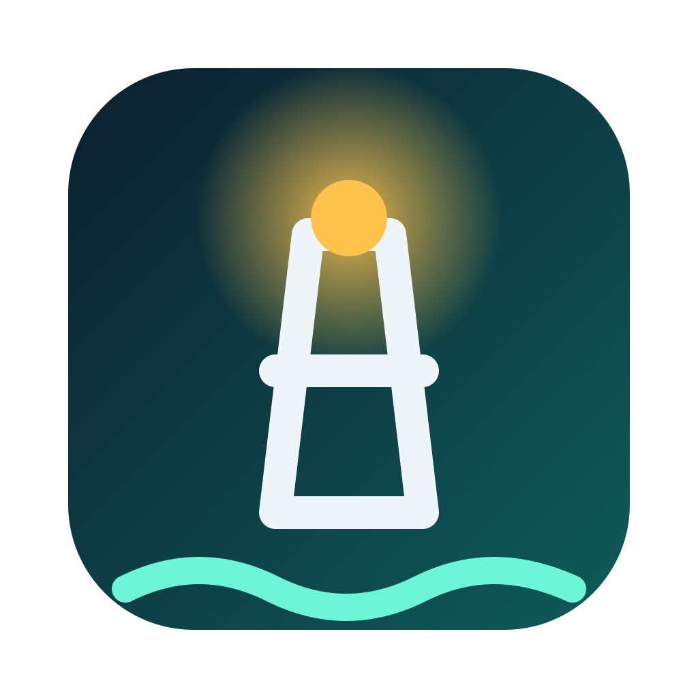

# Harbormaster

Harbormaster is a macOS desktop app for running many coding-agent tasks at
once. Every task gets a berth: its own git worktree, branch, agent session
and terminal pane. A kanban board shows what is waiting, in development,
awaiting something (a review, a deploy, an answer) and done; rules move the
cards as pull requests get reviewed, merged and deployed; one inbox collects
everything that needs you; and agents can launch and message other tasks.
It is local-first and has no telemetry.

## Install

Requirements: an Apple Silicon Mac, [Homebrew](https://brew.sh), and at least
one coding agent installed: [Pi](https://pi.dev) or
[Claude Code](https://code.claude.com/docs/en/setup).

```sh
brew tap finete/tap
brew trust finete/tap        # Homebrew asks this once for third-party taps
brew install --cask harbormaster
```

This puts `Harbormaster.app` in `/Applications` and the `harbormaster`
command on your PATH (agents use it to reach the app). Open the app; a
four-screen setup walks you through:

1. **Your repositories folder**: the first of `~/Code`, `~/src`,

   `~/Projects`, … that exists, else `~/harbormaster` (created for you).
    Every git repository directly under it is picked up, and agents clone
    new repositories into it. Keep code out of `~/Documents`, `~/Desktop` and
    `~/Downloads` (see "Known limitations").
2. **Your agent**: Pi or Claude Code, whichever is installed. Pi users get a

   one-file extension installed into `~/.pi/agent/extensions` automatically;
    Claude Code needs nothing global.
3. **GitHub**: if `gh auth status` is logged in, card moves for your PRs and

   review tasks for other people's PRs are switched on. Otherwise run
    `gh auth login` and re-run the setup from Settings (Harbormaster menu →
    Settings…, `Cmd+,`) → Run setup again.
4. **How it works**: the four concepts below, one screen.

### Upgrade

```sh
brew update && brew upgrade --cask harbormaster
```

The app checks GitHub Releases hourly and shows a small card with that
command (and a copy button) when a new release is out. Behind a
TLS-inspecting corporate proxy, the app trusts the proxy's root CA from the
macOS keychain like your browser does; nothing to configure.

### Uninstall

```sh
brew uninstall --cask harbormaster
```

Your tasks, rules and inbox stay in `~/.harbormaster`; delete that folder
too for a clean slate. Task worktrees live under
`~/.harbormaster/worktrees/<repo>/<branch>` (worktrees made before 0.1.2
stay in `<code folder>/.harbormaster-worktrees` until their tasks finish).

### If the app won't open

The build is not signed by Apple. Homebrew clears the quarantine flag during
install, so it should open normally. If macOS still says the app is from an
unidentified developer, right-click `Harbormaster.app` → Open once, or run
`xattr -dr com.apple.quarantine /Applications/Harbormaster.app`.

## Concepts

### Columns and verbs

Tasks live in four columns: **Backlog**, **Working**, **Awaiting** and **Done**.
There are exactly three verbs to move them: **to working**, **to awaiting** and
**to done** (plus **reopen** for finished work). *Why* a task is awaiting is
data, not a verb: an awaiting kind such as *review* (pushes the branch and
opens or reuses the PR), *deploy* (merges and follows the deployment
stages) or *Slack* (waits on a conversation).

### Rules

Board automation is a list of event → condition → action rules in
`~/.harbormaster/rules/rules.yaml` (with optional per-repository overrides in
`~/.harbormaster/rules/repos/<repo>.yaml`). Sources such as GitHub and
version endpoints produce events; a rule's `if` is a CEL expression; its
actions move a card, add an inbox item, create a task or message one:

```yaml
rules:
  - id: review-changes-requested
    on: github.pr.reviewDecisionChanged
    if: task.state == "awaiting" && event.data.to == "changes_requested"
    do:
      - action: move
        with: { to: working }
```

Defaults are written on first run; every evaluated event and action is
recorded so you can see why a card moved.

### The inbox

One list of everything that needs a human: an agent waiting on you, a review
someone requested, a deployed change ready to land, a launch that failed, a
message between tasks waiting for approval. Each item carries its own
buttons (open the task, create a task, approve, dismiss, snooze). The same
list is available as `harbormaster inbox`.

### Tasks talking to each other

An agent can launch new tasks (as a child it can poll, or standalone), find
tasks and send them messages through the Harbormaster tools (an MCP server
and the `harbormaster` CLI, both thin clients of the running app). Parent ↔
child messages are delivered directly; any other cross-task message lands in
your inbox for approval first.

### Costs

Every task shows what it used: tokens (input, output, cache read, cache
write) per model and per session, read from the agent's own transcripts,
with a dollar estimate next to it when the harness recorded one (Pi does),
labelled *est. at list price · not your bill*. The **Costs** view ranks
tasks by usage with repository / harness / model / date filters, a group-by,
search and CSV export; parents include their subtasks' usage. The same
query is `harbormaster usage --json`. Design notes in `docs/costs.md`.

## Supported agents

- **Pi** and **Claude Code**: fully supported, including status, tools and
message delivery.
- **Any other CLI agent**: runs in a task pane with the same worktree,
branch and session handling. Status works for agents that speak the
OSC 7501 program-status protocol; tools work for any agent that can load
an MCP server or run a shell command. Sending messages *to* an agent needs
per-agent delivery glue; agents without it refuse messages up front.

Pick the default agent in the app; override it per repository or per task.

## Known limitations

- **The build is unsigned.** Homebrew clears the quarantine flag so the app
opens, but macOS ties folder permissions to the exact build: if your code
root is under `~/Documents`, `~/Desktop` or `~/Downloads`, macOS may ask
"Harbormaster would like to access files in your Documents folder" again
after every upgrade. Keep code under a plain folder such as `~/Code` and it
never asks. Signing (and the automatic updater it unlocks) is planned once
there are more than a handful of users.
- **Apple Silicon only.**

## Troubleshooting

- **Logs** live in `~/Library/Application Support/Harbormaster/logs/`:
`main.log` (rotated at 5 MB) records app events, agent launches and
exits, and a `[health]` line every minute (event-loop lag, memory, process
and terminal activity, including each busy terminal's total output since it
started and the window's dropped-frame count). `[health] spike`, `[pass]` and
`[ipc] slow` lines mark moments the app was busy. An identical line repeated
within a minute is written once, followed by a `… repeated N times` note.
- **CPU profiles**: when the app's main process lags or stays above 80% CPU
for a minute, it records a 5-second CPU profile on its own (at most one
every 10 minutes, the newest 3 kept in `logs/profiles/`, one `[profile]` line
in `main.log`). **Help → Profile Main Process (10 s)** records one on demand
while you reproduce something slow. Profiles open in Chrome DevTools, VS Code
or speedscope. Recording uses V8's own profiler inside the app: no debug
port, no external tools.
- **Help → Export Diagnostics…** saves a zip for a bug report: recent logs,
a redacted config, versions, `doctor` and task state, the saved CPU profiles,
each terminal's output totals, CPU/memory/uptime of the running agents (one
`ps` limited to their process ids), the size and entry count of each open
task's agent session file, and the window's recent slow frames and what was
focused. Secrets are redacted, your home folder shows as `~`, prompts and
messages are never included, and nothing is uploaded.
- **`harbormaster doctor`** (or **Check setup** on the Setup screen,
Settings → Run setup again) checks tools, agents, state files,
repositories, disk, the tool socket and PATH; it works with the app down and
exits 1 when a check fails. Local probes time out after 5 s, network probes
(`gh auth status`, `git ls-remote`) after 20 s, at most 5 at a time.
`repos.remote` probes only the repositories with a task in Working or
Awaiting (newest first, at most 5), else the repository of the most recently
updated task; the rest are listed as "not probed (no active task)".
`harbormaster doctor --all-remotes` probes every repository. A remote that
does not answer within 20 s is a warning, not a failure: a remote that
advertises very many refs makes every `ls-remote`/fetch slow. When
`gh auth status` shows api.github.com unreachable, github.com remotes are
not probed. `repos.version-endpoints` GETs each deployment stage's version
URL once; an untrusted TLS certificate (a TLS-inspecting corporate proxy) is
a failure that says so. The app trusts the macOS keychain; the CLI checking
with the app down uses Node, which needs `NODE_EXTRA_CA_CERTS`. `--json`
includes each check's time in `ms`.
- **Export Diagnostics…** (in the Harbormaster menu) zips the logs, a
redacted config and version info into one file to attach to a bug report.
- **More detail:** quit the app, then start it from a terminal with
`HARBORMASTER_LOG=debug /Applications/Harbormaster.app/Contents/MacOS/Harbormaster`
to also log per-chunk terminal output sizes, every IPC call's timing and
each presence poll.

## Future

Harbormaster is about what happens *around* the agent — the review →
merge → deploy lifecycle driven by rules, one inbox for everything that
needs a human, and tasks that coordinate each other. The gaps worth
closing without abandoning that thesis, roughly in order:

- **In-app code review via Plannotator** (MIT / Apache-2.0), integrated as
a product, not a fork: a Review button per task, the review in a pane
beside the terminal, per-harness install/upgrade detection, and the
trigger exposed to rules. Design: `docs/plannotator.md`.
- **Worktree setup scripts** (per repository, run on worktree creation:
install deps, copy `.env`, seed data).
- **More harness adapters**: Codex CLI, Cursor CLI, OpenCode. The adapter
seam exists; each is a contract-test run plus a launch spec.
- **Signed, auto-updating build** (see Known limitations).
- **Remote daemon**: the core API is transport-ready (`docs/design-decisions.md`);
a socket transport would let the app drive agents on another machine.
- **Rules page follow-ups**: Sources/addons tab, dry-run (`rules check`) in
the app, per-rule enable/disable.

Deliberately not planned: a built-in editor, a browser pane, mobile apps,
or multi-agent "races" on one task.

## Development

Requires Node.js 20+ and macOS (Apple Silicon for packaging).

```sh
npm install                     # also rebuilds node-pty for Electron
npm run dev -w @harbormaster/app
npm run lint && npm run typecheck
npm test                        # unit tests (vitest)
npm test -w @harbormaster/app   # app build + Playwright e2e
npm run dist                    # packaged app in packages/app/dist/
```

| Package | Role |
|---|---|
| `packages/core` | Headless core: board, worktree, rules and messaging logic behind a command API. No UI, no Electron. |
| `packages/app` | Electron app: board, task workspaces (dockview + xterm + node-pty), the single automation host. |
| `packages/cli` | The `harbormaster` CLI and MCP server. |
| `packages/extension` | Pi inbox-delivery extension. |

Releases: see [`release/README.md`](release/README.md).

## Architecture

Start with [`AGENTS.md`](AGENTS.md) for the architecture rules, then
[`docs/design-decisions.md`](docs/design-decisions.md) for the decision
record and the core's layering, and
[`docs/release-plan.md`](docs/release-plan.md) for the agent, rules-engine,
inbox and distribution design. Task messaging is described in
[`docs/task-messaging.md`](docs/task-messaging.md).

## License

[MIT](LICENSE) © 2026 finete
