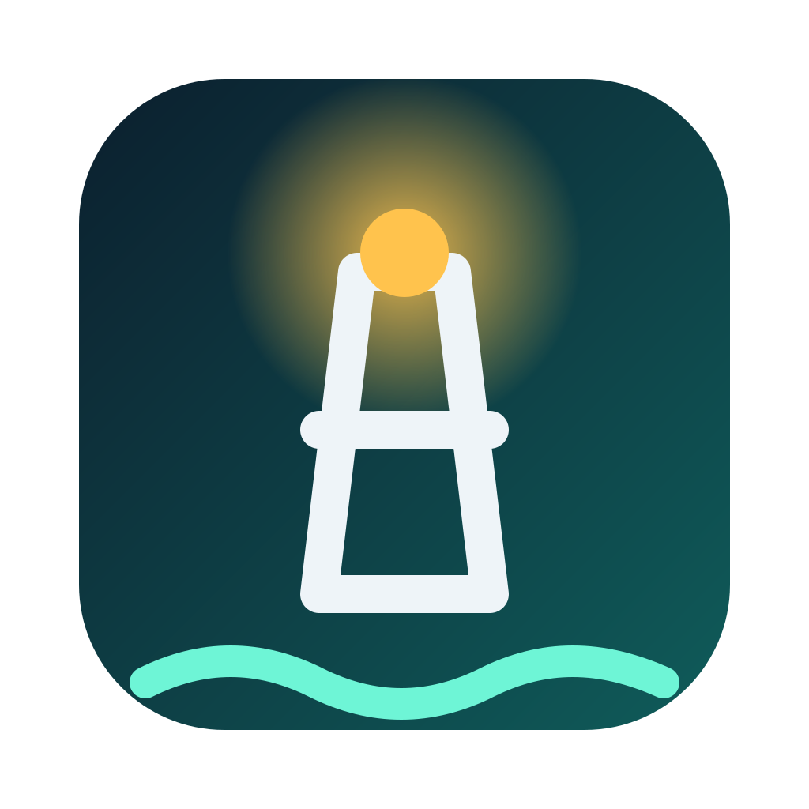

<p align="center"></p>

# Harbormaster

Harbormaster is a macOS desktop app for running many coding-agent tasks at
once. Every task gets a berth: its own git worktree, branch, agent session
and terminal pane. A kanban board shows what is waiting, in development,
awaiting something (a review, a deploy, an answer) and done; rules move the
cards as pull requests get reviewed, merged and deployed; one inbox collects
everything that needs you; and agents can launch and message other tasks.
It is local-first and has no telemetry.

## Install

Apple Silicon Macs, via Homebrew:

```sh
brew install --cask finete/tap/harbormaster
```

This installs `Harbormaster.app` and the `harbormaster` command-line tool.
Upgrade with `brew upgrade --cask harbormaster`; the app shows a banner with
that command when a new release is out. Builds are not notarized (the cask
clears the quarantine flag for you).

GitHub integration uses the [`gh`](https://cli.github.com) CLI; run
`gh auth login` once if you want PR-driven card moves and review tasks.

## Concepts

### Columns and verbs

Tasks live in four columns: **Backlog**, **Dev**, **Awaiting** and **Done**.
There are exactly three verbs to move them: **to dev**, **to await** and
**to done** (plus **reopen** for finished work). *Why* a task is awaiting is
data, not a verb: an awaiting kind such as *review* (pushes the branch and
opens or reuses the PR), *deploy* (merges and follows the deployment
stages) or *Slack* (waits on a conversation).

### Rules

Board automation is a list of event → condition → action rules in
`~/.harbormaster/rules/rules.yaml` (with optional per-repository overrides in
`~/.harbormaster/rules/repos/<repo>.yaml`). Sources such as GitHub and
version endpoints produce events; a rule's `if` is a CEL expression; its
actions move a card, add an inbox item, create a task or message one:

```yaml
rules:
  - id: review-changes-requested
    on: github.pr.reviewDecisionChanged
    if: task.state == "awaiting" && event.data.to == "changes_requested"
    do:
      - action: move
        with: { to: dev }
```

Defaults are written on first run; every evaluated event and action is
recorded so you can see why a card moved.

### The inbox

One list of everything that needs a human: an agent waiting on you, a review
someone requested, a deployed change ready to land, a launch that failed, a
message between tasks waiting for approval. Each item carries its own
buttons (open the task, create a task, approve, dismiss, snooze). The same
list is available as `harbormaster inbox`.

### Tasks talking to each other

An agent can launch new tasks (as a child it can poll, or standalone), find
tasks and send them messages through the Harbormaster tools (an MCP server
and the `harbormaster` CLI, both thin clients of the running app). Parent ↔
child messages are delivered directly; any other cross-task message lands in
your inbox for approval first.

## Supported agents

- **Pi** and **Claude Code**: fully supported, including status, tools and
  message delivery.
- **Any other CLI agent**: runs in a task pane with the same worktree,
  branch and session handling. Status works for agents that speak the
  OSC 7501 program-status protocol; tools work for any agent that can load
  an MCP server or run a shell command. Sending messages *to* an agent needs
  per-agent delivery glue; agents without it refuse messages up front.

Pick the default agent in the app; override it per repository or per task.

## Known limitations

- **The build is unsigned.** Homebrew clears the quarantine flag so the app
  opens, but macOS ties folder permissions to the exact build: if your code
  root is under `~/Documents`, `~/Desktop` or `~/Downloads`, macOS may ask
  "Harbormaster would like to access files in your Documents folder" again
  after every upgrade. Keep code under a plain folder such as `~/Code` and it
  never asks. Signing (and the automatic updater it unlocks) is planned once
  there are more than a handful of users.
- **Apple Silicon only.**

## Development

Requires Node.js 20+ and macOS (Apple Silicon for packaging).

```sh
npm install                     # also rebuilds node-pty for Electron
npm run dev -w @harbormaster/app
npm run lint && npm run typecheck
npm test                        # unit tests (vitest)
npm test -w @harbormaster/app   # app build + Playwright e2e
npm run dist                    # packaged app in packages/app/dist/
```

| Package | Role |
|---|---|
| `packages/core` | Headless core: board, worktree, rules and messaging logic behind a command API. No UI, no Electron. |
| `packages/app` | Electron app: board, task workspaces (dockview + xterm + node-pty), the single automation host. |
| `packages/cli` | The `harbormaster` CLI and MCP server. |
| `packages/extension` | Pi inbox-delivery extension. |

Releases: see [`release/README.md`](release/README.md).

## Architecture

Start with [`AGENTS.md`](AGENTS.md) for the architecture rules, then
[`docs/design-decisions.md`](docs/design-decisions.md) for the decision
record and the core's layering, and
[`docs/release-plan.md`](docs/release-plan.md) for the agent, rules-engine,
inbox and distribution design. Task messaging is described in
[`docs/task-messaging.md`](docs/task-messaging.md).

## License

[MIT](LICENSE) © 2026 finete
